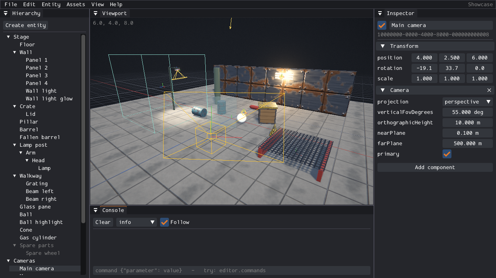

# Cordite

Cordite is a 3D game engine for Windows, macOS and Linux, written in C++20 and rendered
with Vulkan through [NVRHI](https://github.com/NVIDIA-RTX/NVRHI). Its default look is
the gritty, high-contrast, normal-mapped style of late-2000s console games: deferred
shading, deep shadows, strong speculars, bloom and filmic post-processing.

The full product brief is [AIGameEngine.md](AIGameEngine.md).

## Status

Cordite is under active development. Milestones follow the brief:

| # | Milestone | State |
|---|-----------|-------|
| 1 | Engine foundation: build system, core, math, tests, tooling | Done |
| 2 | Window and renderer skeleton: GLFW, Vulkan via NVRHI, swapchain, Slang shaders | Done |
| 3 | Scene and ECS: entities, components, hierarchy, scene files, editor with viewport and command automation | Done |
| 4 | Static mesh rendering: projects and asset ids, glTF import, textures, materials, instanced forward pass | Done |
| 5 | Deferred G-buffer: depth pre-pass, base pass, deferred lighting, forward translucency, debug views | Done |
| 6 | Lighting: directional, point and spot lights, ambient light, clustered light culling, lighting channels | Done |
| 7 | Shadows: shadow maps in an atlas for directional, point and spot lights, cascades for the sun, soft filtered edges | Done |
| 8 | HDR and post-processing: exposure by hand or automatic, bloom, filmic and ACES tone mapping, color grading with lookup tables, vignette, grain, quality presets | Done |
| 9 | Screen-space effects | Planned |
| 10 | Physics and gameplay | Planned |
| 11 | Editor maturity | Planned |
| 12 | Packaging and export | Planned |

## Building

### Windows

Requires Visual Studio 2022 with the "Desktop development with C++" workload.

```powershell
./scripts/bootstrap.ps1     # once: downloads pinned CMake and Ninja into .tools/
./scripts/dev.ps1 build
./scripts/dev.ps1 test
```

### Linux (Ubuntu 24.04+) and macOS

```bash
# Ubuntu: sudo apt install build-essential cmake ninja-build xorg-dev libwayland-dev libxkbcommon-dev
# macOS:  brew install cmake ninja
cmake --preset linux        # or: macos
cmake --build --preset linux-dev
ctest --preset linux-dev
```

All third-party code is downloaded at configure time from archives pinned by SHA-256;
see [docs/third-party.md](docs/third-party.md).

## Running

A Vulkan 1.3 capable GPU and driver are required.

```powershell
./scripts/dev.ps1 run -Target cordite-editor -- --project samples/showcase
```



The picture is one of the reference images the rendering tests compare against. It
shows the showcase project, [samples/showcase](samples/showcase), which uses every
feature the engine has so far: here a sun, a street lamp (a spot light) and a wall
light, all three casting shadows, and a light that shines on the ball alone.

In the viewport, hold the right mouse button to look around and fly with W A S D, Q and
E; hold the middle button to slide; turn the wheel to move forwards and backwards.

## Projects and assets

A game is a project: a directory with a `cordite.project.json` and an `assets`
directory holding models (glTF 2.0: `.gltf`, `.glb`), textures (PNG, JPEG, TGA, BMP,
HDR), materials (`.material.json`) and scenes (`.scene.json`). Every asset has an id
that survives renaming and moving - it is kept in a `.meta` file next to the asset -
and scenes refer to assets by id only. Meshes for blocking out a scene (cube, sphere,
plane, cylinder, cone, capsule, torus) are built in.

The showcase's own textures and models are generated from code by a small tool, so the
repository contains no third-party artwork:

```powershell
./scripts/dev.ps1 run -Target cordite-sample-assets -- samples/showcase/assets
```

## Lighting

A scene is lit by components. `Light` is a directional, a point or a spot light; it
shines from where its entity is, along the entity's -Z axis. `AmbientLight` is light
from all around, from a sky above and a ground below. An intensity of 1 lights a white,
matte surface that faces the light to white - at any distance for a directional light,
one metre away for a point or a spot light, which thin out with the square of the
distance and end at their range.

A view can hold hundreds of point and spot lights: they are sorted into a grid of
clusters, and a pixel only asks the lights near it. Every mesh and every light is in
some of eight lighting channels, and a light shines on a mesh when the two share one.
A scene without lights is black in a game; the editor lights it until it has lights of
its own. The "Light count" view of the editor shows how many lights each pixel asks.

A light casts shadows when it is told to (`castsShadows`): the sun through up to four
cascades that reach as far as its shadow distance, a spot light through one shadow map,
a point light through six. All of them share one atlas, whose size - and with it how
sharp the shadows are - is the shadow quality of the view: off, low, medium or high.
Meshes throw shadows unless told not to; what lets light through throws none.

## The finished picture

The renderer works out light, which has no upper limit; what a screen shows of it is
set by `PostProcess` components. One says how the picture is exposed (by a fixed number
of stops, or automatically, the way an eye gets used to light), how much of what is
brighter than white blooms, which curve brings the light into the range of a screen
(`filmic`, `aces` or none), and how the result is graded: white balance, contrast,
saturation, lift / gamma / gain, a lookup table made in any image editor, a vignette,
chromatic aberration and film grain.

A component applies everywhere, or in and around a box - walk into a cave and the
picture changes with it - or, on a camera, to what is seen through that camera.
Several are laid over one another by priority. A scene that has none gets a filmic
curve and a little bloom. How finely all of it is worked out is a quality like that of
the shadows, and one word - low, medium, high - sets both.

## Automation

Everything the editor can do is a named command that takes and returns JSON, and the
editor runs without a window. A script is a list of commands:

```json
[
    {"command": "entity.create", "params": {"name": "Eye", "components": {"Camera": {}}}},
    {"command": "component.set", "params": {"entity": "Eye", "component": "Transform",
                                            "properties": {"position": [0, 1.7, 4]}}},
    {"command": "asset.instantiate", "params": {"asset": "models/crate.gltf"}},
    {"command": "editor.screenshot", "params": {"path": "out/eye.png"}},
    {"command": "scene.save", "params": {"path": "out/eye.scene.json"}}
]
```

```powershell
./scripts/dev.ps1 run -Target cordite-editor -- --headless --project samples/showcase --exec script.json
```

The outcome of every step is written to standard output as JSON, and the exit status
says whether the script ran to the end. `editor.commands` lists every command with its
parameters, `component.types` describes every component and property, and `asset.list`
shows every asset; that is what an AI agent reads to find out what it can do. The same commands can be typed into the
console panel of the interactive editor. `--help` lists every command-line option.

## Documentation

- [AGENTS.md](AGENTS.md) - how to work in this repository: commands, coding standards,
  testing and review rules. Written for both people and AI agents.
- [docs/architecture.md](docs/architecture.md) - module map, conventions and the
  reasoning behind the main design decisions.
- [docs/third-party.md](docs/third-party.md) - every library the engine uses, with
  versions and licenses.
- [.claude/skills](.claude/skills) - step-by-step guides for recurring tasks: building
  and testing, adding a component, a render pass, a dependency or an editor command,
  and working with assets.
- Public APIs are documented in their headers under `engine/cordite/`, each with a
  usage example.
